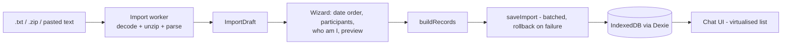

# Chatss architecture

## Data flow

Everything runs in the browser. There is no server component.

## Parser

`src/lib/parser/parseChat.ts` is a line-based state machine:

1. Each line is tested against two header patterns: iOS `[date, time] rest` and Android `date, time - rest`. Both tolerate `/ . -` separators, 1–4 digit fields, optional seconds, `am/pm/a.m.` markers, NBSP and narrow NBSP spaces, and leading direction marks.
2. A matching line starts a new message. Any other line is appended to the current message. Text before the first header becomes an `unparsed` message and is reported as a warning.
3. The sender separator is the first colon on the header line followed by a space, a newline, or the end of the text. Known English system notices, such as `X changed the subject from "a: b"`, are checked first. Their actor is never allowed to contain `": "`, so `Asha: I added a note` stays a normal message.
4. Message bodies are classified (`classify.ts`) into media placeholders, attached files (`(file attached)` / `<attached: …>`), deleted, call, or text. A trailing `<This message was edited>` marker is turned into the `edited` flag.
5. Date order (`dates.ts`): an order is a candidate only if every header date is valid under it. If DMY and MDY both fit, the reading that keeps the chat in chronological order wins. When that still doesn't settle it, the user is asked.

## Timestamp convention

Exports contain wall-clock times with no timezone. Chatss stores `ts = Date.UTC(y, m-1, d, h, min, s)`, which is the wall-clock time encoded as if it were UTC, and always formats with `timeZone: 'UTC'`. This "floating local time" can never be shifted by the viewer's timezone or by DST. The original string is also kept in `tsText`.

## IndexedDB schema (Dexie, version 1)

| Table | Key | Indexes | Notes |
| --- | --- | --- | --- |
| `conversations` | `id` | `status`, `importedAt`, `latestTs`, `fingerprint` | Includes `selfParticipantId`, the viewing perspective. |
| `participants` | `id` | `conversationId` | Stores `originalName`, `aliases` (merged senders), `displayName` and `normalizedName`. |
| `messages` | `id` = `conversationId:order` | `conversationId`, `[conversationId+order]`, `[conversationId+ts]`, `[conversationId+senderId]` | Never changes after import. |
| `attachments` | `id` | `conversationId`, `messageId` | Metadata only, with `status` set to `available` or `missing`. |
| `blobs` | `id` (= attachment id) | `conversationId` | `ArrayBuffer` bytes, kept separate so metadata queries never load files. |

- **Perspective** lives in `conversations.selfParticipantId`. Changing it is a single-field update, and messages are never duplicated or rewritten.
- **Import status:** a conversation is written as `importing` and switched to `complete` only after every message and attachment is stored. A failed import is deleted. Leftover `importing` rows from a crash are cleaned up at startup, and incomplete chats are never listed.
- **Migrations:** add a new `this.version(n).stores(...).upgrade(...)` block, keep the old version blocks, and never delete user data in an upgrade.

## Rendering

- `rows.ts` flattens messages into rows with date separators and marks the first message in each run from the same sender, which gets the bubble tail.
- `MessageList` uses `react-virtuoso`, so only about 30–60 rows are in the DOM at a time. It opens at the latest message, or at the saved position or a search hit.
- `perspective.ts › sideOf()` is the single rule for alignment: messages from `selfId` go right, other messages go left, and system notices are centred.
- Text is rendered through `richText.ts` → React text nodes. `dangerouslySetInnerHTML` is never used.

## Security notes

- The production CSP (injected at build time in `vite.config.ts`) allows only `'self'` for scripts and connections, plus `blob:`/`data:` for images and media.
- ZIP entries are handled in `zip.ts`. Paths with traversal, absolute paths, control characters, or `__MACOSX` metadata are ignored. Limits apply to entry count, archive size, per-file size and total size, and entries with an extreme compression ratio are rejected. Declared sizes are checked again after decompression.
- Only PDFs can be opened in a new tab. All other documents are downloaded as `application/octet-stream`.

## Extension point: app lock (not implemented)

A future app lock would go in `App.tsx`, around `<Shell/>`: a gate component that asks for a PIN or a WebAuthn platform authenticator before rendering. That only stops people using the UI; it does **not** encrypt IndexedDB. Real at-rest protection would require encrypting message text and blobs with a key derived from a passphrase (for example PBKDF2/Argon2 → AES-GCM via WebCrypto). Search would then have to run on decrypted data in memory.
